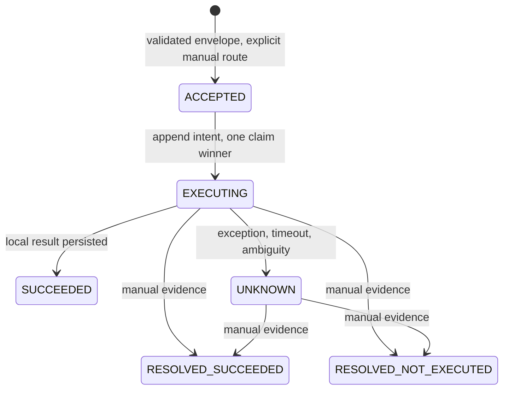

# Architecture / 構成

## Dependency inventory

| Layer | v0.1 state | Dependency / unresolved assurance |
|---|---|---|
| Generic command core | Implemented locally | Node.js built-ins; trusted caller/configuration |
| Local append-only journal | Implemented locally | Cooperative process lock and trusted local disk |
| Synthetic executor | Implemented demo | No network or business effects |
| Ed25519 verification | Implemented, RFC vector tested | Trust enrollment, rotation and real signed-command integration unverified |
| Independent transport | Not supplied | No formally verified independent service entry in this scope |
| Real executor | Not supplied | No documented authorized chat execution entry verified here |
| Private GitHub queue | Future design boundary only | Private access, least privilege, signatures, CAS, polling and failure semantics still required |

The prior operational design used the same official service for direct and relay calls. This candidate does not copy its data or integrate with it. A source-code release changes neither that dependency nor service availability. No unofficial automation endpoint is invented.

## Processing flow

1. Caller supplies an envelope and manual route decision. Default signature mode is Ed25519; synthetic demo explicitly selects simulation.
2. Canonicalize a JSON snapshot; require exact fields, fixed audience, key trust, validity, and allowlist. Signature covers every command field, including identity, audience and payload.
3. Journal accepts once. Same ID / same digest returns existing state; a conflicting digest is refused.
4. On explicit execute, recheck route, validity, policy and signature. Under a cooperative lock, exactly one caller may append EXECUTING.
5. Only that winner invokes the executor. SUCCEEDED is recorded after a narrowly shaped successful result. Exception, invalid result, timeout, or result-storage failure is UNKNOWN or durable EXECUTING. Neither may run again.
6. Reconcile appends RESOLVED_SUCCEEDED / RESOLVED_NOT_EXECUTED with an opaque evidence reference. Neither state enables execution.

A crash after intent but before the callback may leave EXECUTING even if nothing happened. This is deliberate loss of availability, not permission to replay. A callback may complete after timeout; no late-success transition overwrites UNKNOWN.

## Data and ownership

Journal command directories contain sequential immutable JSON events. Each event binds sequence, previous checksum and data checksum. Creation uses exclusive file creation, file fsync and a cooperative directory lock. Re-read validates sequence and state transitions. Directory-entry power-loss durability, hostile file replacement and network filesystems are not guaranteed. Never delete a stale lock without investigating the interrupted writer.

The caller owns trustworthy routing evidence, wall clock, key enrollment and identity mapping. The executor owns its own idempotency and result semantics. The supplied callback is trusted code, not sandboxed. The local journal cannot prevent another route, deleted ledger, different ID or different machine from causing duplicate business effects.

Canonical encoding is this implementation's sorted JSON format, not a claim of full RFC 8785 interoperability. A future signer must implement exactly this format and use test vectors. Non-finite/unsupported JSON values are refused. Wall clock correctness is assumed.

## Minimal privileges

The demo needs only read access to source and write access to its temporary local journal. It uses no credential, environment-secret loader, shell action, HTTP listener, service account or persistent process. Execution allowlist uses exact target/action matches; there is no arbitrary command string interpreter.

## Reconciliation and active execution

A per-command local active guard blocks reconciliation while the callback or result persistence is still running, including after a timeout and across cooperating instances sharing the same journal. Normal settlement removes only that execution's guard. A crash or guard-removal failure can leave a stale guard; there is no automatic expiry/removal. Operator investigation of the original process and effects is required before any manual maintenance. The library does not expose an automatic stale-guard recovery path.

An evidence ID is an operator's assertion/reference, not independently verified proof of non-execution. Do not report RESOLVED_NOT_EXECUTED as an authenticated external fact. The route fields likewise do not implement exclusion with a separate direct route. Trusted operator coordination remains necessary.

## B content handoff example

Trusted fictional bytes + expected digest -> host size/schema/hash check -> no-answer stdin envelope -> synthetic reply (offline) -> exact schema/correlation/task-result check. The generic relay core is unchanged. The public example contains no live CLI executor. A real CLI can be a separately reviewed adapter, using official stdin and existing authorized authentication; public queues/comments do not grant execution authority.
